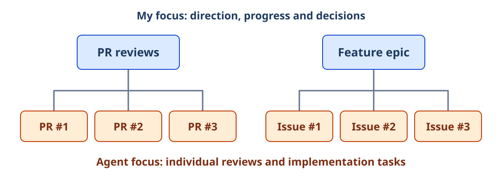
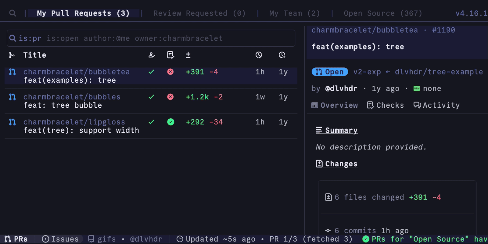
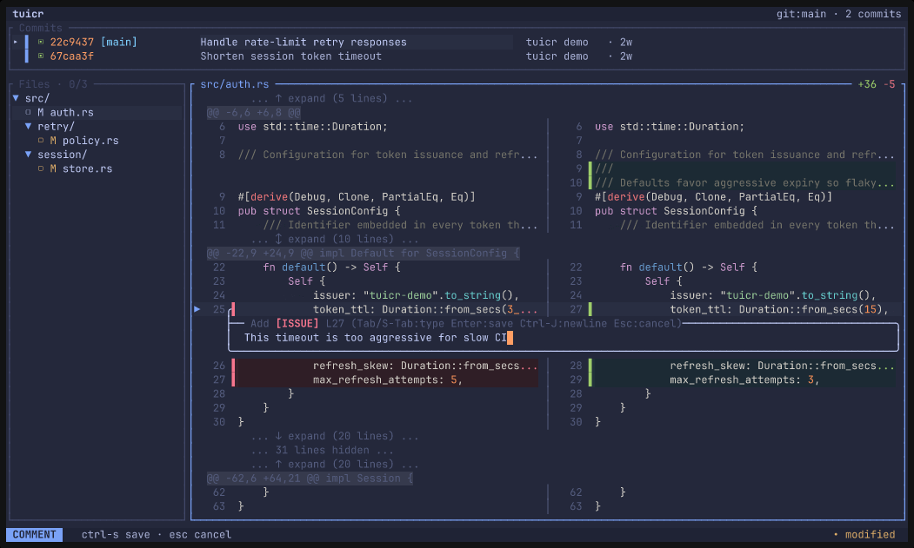
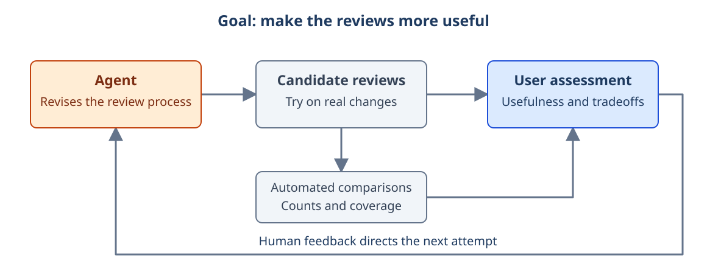
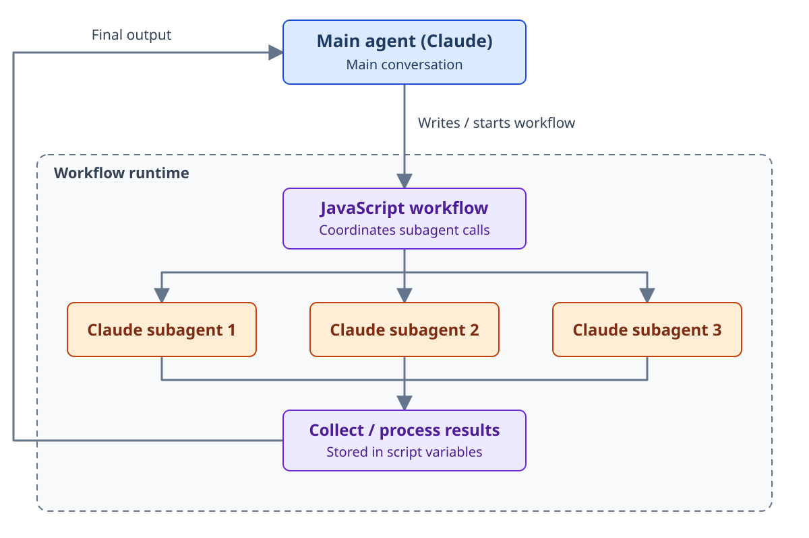
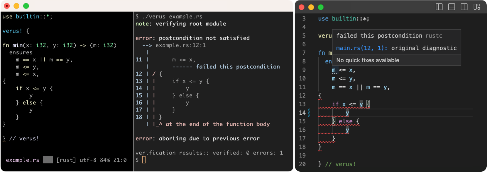
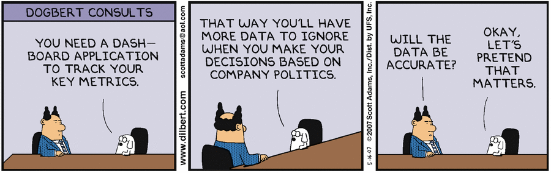

## Introduction

In my [last post](/blog/2026/07/03/legibility-agents/), I discussed the bargain agents offer us. They make it much easier to work within strict systems, from Rust's type checker to Bazel's dependency graph, while separating the production of software from the understanding that used to come with writing it. I want to pick up the second half now, because the agents are doing plenty of work, and I am spending a substantial part of my day helping that work take its next step.

Before we go any further, my engineering-manager brain insists on a taxonomy. Humor me for one second. My work falls into three broad categories:

- Developing my own work, often across an epic, up to the point where it is ready for review.
- Reviewing other people's work and giving them useful feedback.
- Addressing the comments others leave on my work and getting pull requests through to merge.

As I described in [It's Agents All the Way Down](/blog/2026/02/14/agents-all-the-way-down/), agents now do much of the work within those stages. My attention moves between them: what is ready, what is stuck, what needs a decision and what can keep going without me?

Picture a tree of work: I am focused on a node, with agents working on the tasks below it. For a set of pull request reviews, I decide what needs attention while agents examine individual changes. For a feature epic, a collection of related development tasks, I think about how the pieces fit together while agents work on the issues.



_The colors show our main areas of focus, not a boundary that prevents me from inspecting a task._

I think of this as working one level up: a supervisor-first model of work. I still get into individual reviews and implementations, but my attention now constrains how much work I can direct. I need a view that leaves out enough detail to be useful without hiding the things that need my judgment. This brings James C. Scott back into the picture. In *Seeing Like a State*, Scott examines how institutions make a complicated world administratively legible. Standard measures and simplified categories let the center see and act, while leaving much of life outside its picture. My review queue is a smaller affair, but I am making a related choice: which dimensions of the work should appear in the view I use to manage it?

My limited capacity to supervise is part of that legibility problem. Giving me every transcript, intermediate file and test result would make more information available, but I would still have to find the important relationships and decisions inside it. We are choosing ways to make the work understandable from our position. A dashboard shows its state, a goal says what it should achieve and a workflow specifies how it should proceed.

I want to work through those choices, starting with the tools I use to inspect the work and give feedback. From there, we can look at goals, graphs and audits, then ask whether an agent could take over some of my work at the parent node. Follow that far enough and we begin to recreate a familiar arrangement: workers, supervisors and supervisors of supervisors. We are on our way to an agentic organization, with some very old questions about what the people at the top actually know.

## Interfaces: see the state, then inspect the work

Two critical tools in my current workflow are [gh-dash](https://github.com/dlvhdr/gh-dash) and [tuicr](https://github.com/agavra/tuicr). Both are terminal tools. Together, they let me move between the simplified picture and the work behind it.

### gh-dash: the queue and the way into the work

gh-dash organizes GitHub pull requests and issues into configurable views. I can see what needs review, check my own changes and decide what to pick up next. The launcher scripts around it connect an item in the queue to the appropriate agent session or review tool, so choosing the work also gives me a way to address it.



_gh-dash's public demonstration, showing the pull request queue and detail pane. The launcher scripts I use sit around this interface. [Source: gh-dash](https://github.com/dlvhdr/gh-dash/blob/e6752f8f2cf10f650d4f6e136385ba70f57d11f1/docs/src/assets/overview.gif). This is not a company dashboard._

This is great for my productivity. To start an agent review, I highlight a row and press `Shift+C`. To address reviewer comments on my own pull request, I press `Shift+A`. Indicators show continuous integration failures, with more shortcuts to investigate them. Those bindings belong to my launcher configuration, not a universal gh-dash setup, but they put routine work one keystroke away.

I also have agents write handoff scripts as they work. If I come back for a second pass at reviewer comments, the next run can pick up the recorded context instead of asking me to reconstruct the previous conversation. A shortcut gets me into the task, and the handoff gives the next agent a starting point. Together, they make it much easier to leave work running, turn my attention elsewhere and return when something needs me.

The work is at the center, rather than buried in a conversation I have to find and remember. The dashboard flattens activity into a state I can act on, but that state is only the beginning of understanding a change. A green check tells me that a check passed; it does not tell me whether we built the right thing.

### tuicr: a short path back into the work

Once I get into a change, tuicr is the best tool I currently have for editing with an agent. It presents files or diffs in a review interface and attaches comments to the relevant passages. The agent receives the feedback with file and line references, without me copying text into chat and explaining which part I meant.



_An inline comment in tuicr's public demonstration. The same feedback mechanism works for prose and specifications. [Source: tuicr](https://github.com/agavra/tuicr/blob/f098fb8f0911f6b9b14c80e23f79ab084cf5ef91/public/tuicr-demo.gif)._

Writing with AI is a little controversial these days. Erich Grunewald makes a strong argument [against using AI for substantive drafting](https://erichgrunewald.substack.com/p/why-you-should-almost-never-use-ai), including drafts we plan to edit. But I obviously disagree, as this is an AI-written blog post, and I strongly believe that editing the generated text is where I do much of the deeper thinking and take ownership of what the piece says. To make that work, I need every draft in front of me. tuicr lets me question the argument, reject wording that does not express my position and discover that I meant something different from what I initially asked for.

For code, the division of attention is different. At the volume agents now produce, I do not regard reading every generated line as a practical default for my workflow. I still need to inspect consequential parts of a change: the boundary where permissions are checked, a new assumption about data or the test that claims to establish the behavior. tuicr gives me a short route from a task in the queue to the relevant diff. I am looking for signs of quality and for patterns that might require a deeper intervention, rather than accepting the agent's account as my only evidence.

There is an old quality-control problem behind this. The [NIST account of acceptance sampling](https://www.itl.nist.gov/div898/handbook/pmc/section2/pmc21.htm) describes military bullet testing: testing every bullet destroys the product, while testing none leaves the customer exposed to defects. Harold Dodge and Harry Romig helped develop the sampling methods; [Abraham Wald's wartime work](https://epub.ub.uni-muenchen.de/1808/1/paper_439.pdf) developed sequential methods that could stop inspection once enough evidence had accumulated. A sample can tell you that you need to reject or investigate a batch without inspecting every item in it. While code is not a batch of interchangeable bullets, I can sample for patterns and investigate further. If I find the same mistaken assumption in two places, that is a reason to question the process that produced the change, widen the review and perhaps send the agent back with a different understanding of the task. Finding nothing in those places does not certify everything else, but the agents reviewing the change in detail provide an additional layer of assurance.

I think this interaction should be available almost everywhere we work with agents. A specification, a design document and a blog post all benefit from being able to point at the work and discuss it in place. The file becomes part of the conversation.

## Goals: supervise through the outcome

Dashboards and inspections help me see what needs attention; well-defined agentic workflows let me guide the work without supplying every next instruction.

The first approach to supervision is familiar from delegating to a person: make the outcome explicit and give the worker room to find a route. A goal says, achieve X within these constraints. The agent can change its approach as it learns, while we have something more stable to discuss than whether it followed my last suggestion.

We have tried this at Delphos Labs. Most recently, I asked Claude to audit my pull request review workflow and adapt it for current Claude and Sol models. I supplied recent pull requests as benchmark material and high-level feedback inspired by Anthropic's [prompt-audit guidance](https://github.com/anthropics/skills/blob/main/skills/claude-api/shared/prompt-audit.md). I wanted the agent to investigate and improve the process, rather than execute a list of edits I had already decided on.

Most of the changes happened without deep human review. Instead, I used the reviewers while the audit was ongoing: iterate, try them on real work, iterate again. I also reached out to colleagues as they received reviews. Their responses helped refine my feeling for what was working.

I paired that with measurements the agent could derive more quickly, such as the number of review comments and their coverage compared with earlier revisions. Those comparisons gave it something to work with between my responses. More comments did not automatically mean a better review; a change in coverage was something to examine alongside the usefulness of the findings.

I was still involved, but the involvement was different. Reading every instruction change would have made me the editor of the review system. Using it while it changed made me a source of feedback about its behavior, including the parts that are difficult to specify in advance: whether a comment is useful, whether a review directs attention to the right place and whether the whole exercise helps someone make a better decision about the change. The measurements and human responses let us compare attempts without pretending that one number captured review quality.

That gives us a richer goal loop than repeatedly asking an agent to drive a counter to zero. The agent makes a change, produces work under the new arrangement and collects measurements. I use the result and supply judgment that shapes the next attempt. The assessment can be partly automated and partly human; the things we care about need not collapse into a single numerical score.



_The user is part of the assessment, not merely the person who writes the initial prompt. Automated measurements provide faster feedback between human judgments._

There is a familiar version in agile development. The [Agile Manifesto's principles](https://agilemanifesto.org/principles.html) emphasize early and continuous delivery of valuable software and close collaboration. In that sense, agile is a goal loop: put software in front of the user, learn whether it serves the purpose and change what you do next. The user's response is part of the measure of progress, not a distraction from finishing the original plan.

Geoffrey Huntley's [Ralph Wiggum loop](https://ghuntley.com/ralph/), described in July 2025, paired persistent agent work with specifications, tests and human feedback. Now that persistence is becoming a product feature: Claude Code's [`/goal` command](https://code.claude.com/docs/en/goal.md) uses a separate model to assess a completion condition after each turn and starts another if it is unmet, without waiting for you to type "continue."

A goal lets me specify the outcome without prescribing the route, but its measure has to reflect what I want. "Find more issues" can reward noise if plausible but incorrect comments count as progress. Claude Code's evaluator reads the conversation rather than independently checking files or running commands, so feedback from actual use and colleagues matters: repeated attempts can otherwise reinforce a shared misunderstanding. That freedom is exciting, but someone still has to collect the reviewers' results, handle failed workers and validate findings before they reach the author.

## Graphs: supervise through the procedure

For that, we can make the procedure explicit in an executable workflow, or "graph": which reviews must happen, what runs in parallel and how findings reach validation. Graphs and subagents are not new; what is exciting is how readily an agent can now turn a description of work into a program coordinating other agents. In an ordinary subagent conversation, the model decides what to launch next. In Anthropic's [dynamic workflows](https://code.claude.com/docs/en/workflows.md), Claude instead writes a JavaScript orchestration script that the runtime executes. The script handles sequencing, waiting and passing results along, leaving me a procedure I can inspect and run rather than a process the model must reconstruct at every transition.



_In a dynamic workflow, the main agent (Claude) writes a script that the workflow runtime executes. The script dispatches subagents, collects their results in variables and processes them, optionally calling another subagent to synthesize the findings. Only the final output returns to the main conversation. Original diagram based on [Anthropic's documentation](https://code.claude.com/docs/en/workflows.md)._

A graph can launch independent reviewers in parallel, wait for their results and send failed work back for correction. It need not prescribe every action inside a massive skill file or prompt for an agent to adhere to. A worker can pursue a goal while the surrounding graph determines how its result moves through the system. This makes goals and graphs into complementary approaches.

This is how our review work at Delphos Labs is developing. A script drives preparation and discovery, including a subagent's assessment of how to review the change, then fans the reviews out across a team. The models do the assessment; the procedure determines how to collect and use it. Anthropic's [Code Review service](https://code.claude.com/docs/en/code-review) describes a related pattern of parallel review followed by verification, ranking and publication.

We can specify who sees what, too. Dave Rensin's [Elephant-Goldfish model](https://opensource.googleblog.com/2026/10/introducing-elephant-goldfish-model-plugin.html) separates a context-rich design discussion from fresh sessions assessing the resulting specification. The Elephant knows the history; a Goldfish must make sense of the document without it. A workflow can encode that separation and make the handoff available for inspection. If the fresh reviewer cannot understand the plan, something important never made it into the artifact.

With a goal, I can ask whether we achieved the outcome. With a workflow, I can also ask whether the required review happened and which step failed. I can inspect the procedure separately from the judgments made during a run. A completed review can be wrong, but a missing review should not disappear inside a polished summary.

A script can run a bad procedure perfectly, of course. Scott's warning belongs here too: making a practice orderly and controllable does not establish that it captures what matters. We now have a procedure we can examine, change and delegate. But are its checks looking at enough of the work?

## Audits: does the whole thing still make sense?

Imagine an epic completed through a hundred small changes. Each issue has acceptance criteria. Each pull request passes its tests and gets a review. By the end, who has checked whether the assembled feature matches the design, whether permissions agree across services or whether a decision made on the third task became invalid on the seventy-third?

This problem did not begin with agents. Small changes are easier to understand, test and revise, but the unit of review can be smaller than the unit whose behavior we care about. Fresh sessions can make the gap more pronounced if each receives only its current task and nobody takes responsibility for reconstructing the whole.

That gives us a third kind of supervision alongside goals and workflows: system-level audits. An auditor needs the intended behavior, design decisions and current implementation to trace user journeys, test assumptions at component boundaries and connect findings from individual reviews. *Software Engineering at Google* describes how [larger tests](https://abseil.io/resources/swe-book/html/ch14.html) expose integration and emergent-behavior gaps; the companion *Site Reliability Engineering* book describes [Launch Coordination Engineering](https://sre.google/sre-book/reliable-product-launches/), which audits architecture, dependencies, capacity and operational readiness. A human engineer may carry integrating knowledge from design through implementation, though that continuity is imperfect even on human teams. With agents completing bounded tasks in separate sessions, I want responsibility for integration to be explicit, not assumed. A fresh perspective should not mean a context-starved one.

Formal methods offer an interesting way to make parts of that larger picture checkable. In September, Claude Code creator Boris Cherny [reported using Lean and TLA+ to investigate the Claude Agent SDK](https://x.com/bcherny/status/2102543349102338309), producing fixes for bugs and race conditions. His report points toward agents helping us construct and explore a model of the system, not just inspect a patch.



_This function promises to return the smaller of two inputs, but returns `y` in both branches. Verus flags the failed requirement: the result must be no greater than `x`. Screenshot from the [Verus README](https://github.com/verus-lang/verus#readme), reproduced under its MIT license._

[Lean](https://lean-lang.org/learn/) lets us state mathematical claims and check proofs. [Verus](https://github.com/verus-lang/verus) lets developers specify properties of supported Rust code and prove that the code satisfies them. We might ask whether a state transition preserves an invariant, or whether a sequence of operations can put the system into a forbidden condition. A method can be applied to a single function or to a composition of components; formal does not automatically mean comprehensive. The larger assurance comes from choosing properties and a scope that cover the interactions we actually care about.

Google DeepMind's [AlphaProof Code work on Signal](https://deepmind.google/blog/introducing-alphaproof-code/), published on November 10, paired human-reviewed security specifications with about 6.5 million lines of agent-generated, checked Lean proof about compiled libsignal code. Reintroducing two previously fixed bugs confirmed that the specifications caught those flaws. The [paper](https://deepmind.google/documents/36/Formal_Verification_of_Signal_4.pdf) covers selected security properties of one-to-one sessions in a particular build and modeled environment, not all Signal behavior. Its guarantees still depend on specifications, cryptographic assumptions and trusted components; a correct proof can answer a question that is too weak.

The authors' most interesting observation is where human effort went: once proofs became cheaper, the hard question became what to prove. Specifications needed repeated human-agent review and sometimes rewrites for legibility; someone still had to understand and take responsibility for the statement being proved. Beyond formal verification, consider a book: individually reviewed chapters can still contradict one another, leave gaps in the larger argument or assume knowledge the reader was never given. A book-level auditor would examine the whole manuscript against its sources, intended audience and overall purpose. Supervision moves from checking individual pieces to assessing what they add up to.

## Supervisors: delegate the parent node

Now put those responsibilities together. I have work to select, goals to assess, workflows to operate and a system whose coherence needs checking. Making them explicit has given me more capability, but not more hours in the day.

I wrote about the [attention cost and fatigue of constantly switching between agent sessions](/blog/2026/04/18/marginal-analysis/) earlier this year. Every return asks me to reconstruct enough context to make the next decision. As I push the number of tasks higher, more work can be available to inspect while less of it is meaningfully legible to me. Adding another dashboard does not, on its own, restore my capacity to understand it.

A workflow can coordinate its internal steps, but someone still has to choose which work enters it, respond when it cannot proceed and connect its result to the larger project. Adding more workers may simply give me more completed tasks to interpret. Some of the work of following progress and recognizing exceptions has to happen below me. We have now described enough of that supervisory job to begin assigning parts of it to an agent.

Return to the opening diagram. At Delphos Labs, we are working on supervisor agents, inspired by [DeepSeek Harness](https://github.com/deepseek-ai/deepseek-harness), that could take over some of my work at the parent node while I operate one level up. The launchers already expose operations I invoke from the dashboard. An agent can inspect the underlying state and invoke them without reproducing my terminal layout.

Our workflow model already supports supervision: the main agent can monitor workers, intervene and make decisions within a run. The supervisor model moves authority up another level. Who decides what work gets reviewed at all, when to launch a workflow and what happens after it finishes? That is a different job from supervising reviewers inside a single task. The supervisor can choose and initiate work across the stream without necessarily having authority to approve or merge the resulting changes.

A "harness" is the software around the model that manages tools, working state, permissions and agent execution; workflows run within it. DeepSeek Harness is a plugin-based implementation whose [subagent interfaces](https://github.com/deepseek-ai/deepseek-harness/blob/master/docs/subsystems/subagent.md) support discovery, messaging, interruption and result collection. They distinguish durable sessions from individual runs, and normal completion from errors, cancellation or token-limit stops, giving the supervisor more reliable evidence about what happened.

The interface I am building around this still lives in tmux, the terminal multiplexer that lets me keep multiple sessions and windows running. A session corresponds to a high-level stream of work or a goal. Its supervisor creates task windows and keeps each task attached to its own Git worktree. OpenCode or Claude Code runs inside the task window, and can open additional windows for tuicr or a long-running process whose output needs watching. The supervisor can message the workers and check their progress without making me visit each window in turn.

```text
tmux session: a feature epic
  supervisor: coordinates this stream of work
  window: issue 1 / OpenCode / worktree 1
  window: issue 2 / Claude Code / worktree 2
  window: tuicr review for issue 1
  window: long-running tests for issue 2
```

This gives me a human interface to the same organization the agents are operating. I can enter a task, inspect its files, read the discussion or provide feedback. The handoffs and working directories give the supervisor stable places to associate with that task. A worktree separates the task's working files; it is not, by itself, a security sandbox.

The arrangement does not depend on tmux. Colleagues use [Paseo's workspaces and orchestration](https://paseo.sh/docs/parallel-development), while [Herdr](https://herdr.dev/tui/docs/agent-automation/) and [cmux](https://cmux.com/agents) expose ways to create terminal workspaces, launch agents and inspect or direct their work. Their capabilities differ, but the common design is a durable place for a task, a worker acting in it and a layer coordinating the work.

What I receive is another simplified view. "All reviews complete" must distinguish a clean result from a failed worker or unresolved disagreement. I might follow a reported blocker into a failed check, open the change in tuicr and send feedback to the worker. Moving one level up should not mean losing the ability to move back down.

## And then we invent an organization

Once an agent can choose and launch workflows, it occupies part of the role I have been describing for myself. One supervisor could coordinate reviews and another implementation, with someone above them directing the related work. Follow that arrangement upward and we have workers, supervisors, auditors, bounded authority and escalation paths. We have just invented the agentic organization and promoted ourselves to the brand-new role of Senior Vice President of Agent Engineering. Enjoy the perks.

And before you know it, there is another engineering-productivity dashboard for you to monitor. At least this time you can ask an agent to explain why all the indicators are green and the feature still does not work.



_Scott Adams, Dilbert (2007). Image supplied by the author; original attribution retained._

The organization distributes understanding as well as execution. A worker needs the detail of its task; a supervisor needs progress and unresolved questions; an auditor needs to see across task boundaries. This is the recurring relation in the [Alt Binaries reading of Scott](https://altdotbinaries.com/2026/05/11/metis-vs-techne/): the supervisor simplifying work below becomes a summarized task in someone else's view above. We gain capacity because nobody has to absorb everything. The price is that each level depends on choices about what to preserve, so the view from above must remain open to correction from below.

That makes authority and reporting engineering responsibilities. A supervisor needs defined permissions, failures that remain visible and evidence behind its account. Workers need a way to question their assignments, and the auditor needs enough context to recognize problems that do not belong to any single task. I still need to be able to open the work in tuicr, investigate a surprising finding and change the goal or procedure. Delegating the routine should make those interventions more useful, not make them impossible.

If a supervisor takes over the queue, I will spend less time looking at it. Some of that is the point; some could mean missing a pattern I would have noticed by being there. When that happens, I want to improve the observer or build the audit that brings the pattern to my attention next time, rather than resolve to watch every task forever. That is the observability lesson I want to carry into this arrangement: what we fail to see should inform how we build the next view.

There is a huge opportunity for engineering creativity here. I know some engineers are unhappy about writing less code themselves. But designing roles, communication channels, checks and interfaces calls on the same analytical skills, now applied to the organization producing the software. We can multiply our contribution by improving the conditions under which all that work happens. For those of us working extensively with agents, this is a daunting kind of career growth, with new habits and a transformed working day. It does not mean we have stopped being engineers.

The destination I want is greater capability with enough understanding to use it well. My limited attention was the reason for building these supervisory arrangements, not a defect I can eliminate by reading harder. I want the right questions to reach me, the ability to investigate beyond the report and room to change the organization when it stops serving the work. That sounds like a substantial promotion. I suspect we will earn it.

## Tools Used

- [OpenCode](https://opencode.ai/) with GPT-6.1 Sol for research and drafting
- Perplexity for source discovery
- [gh-dash](https://github.com/dlvhdr/gh-dash) and [tuicr](https://github.com/agavra/tuicr) for the workflows discussed here and feedback on the draft
- Public documentation and source code from Anthropic, DeepSeek Harness and Paseo
- James C. Scott's *Seeing Like a State* and the Alt Binaries essay discussed in the previous post
- NIST's acceptance-sampling handbook, the Agile Manifesto and Google's software engineering and site reliability books
- Lean, Verus and Google DeepMind's AlphaProof Code paper for the verification examples
